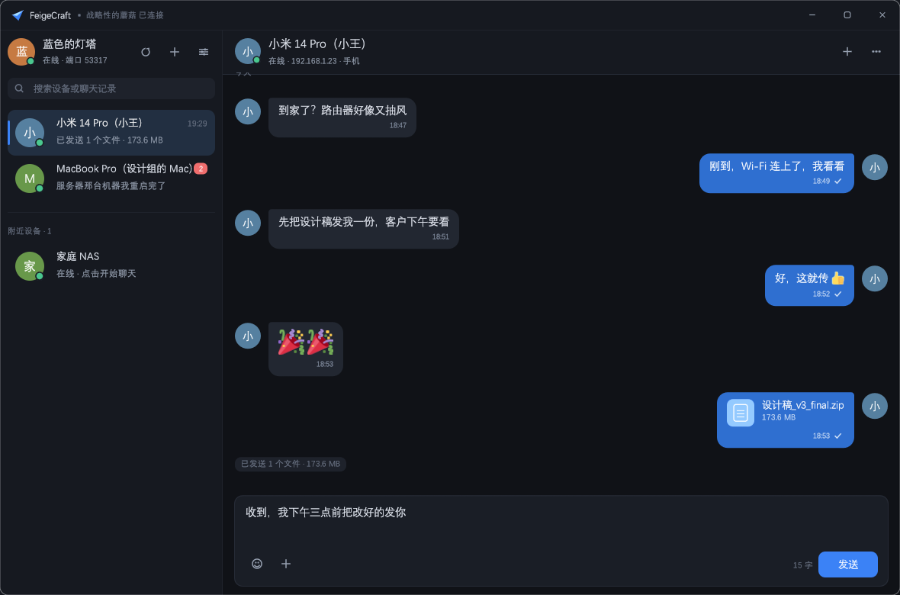
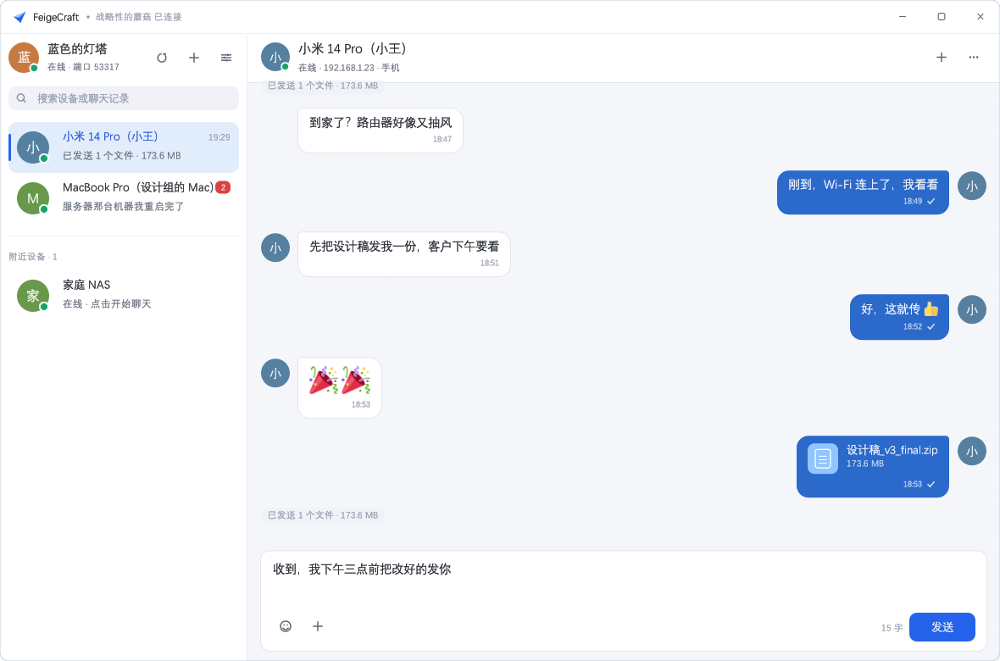
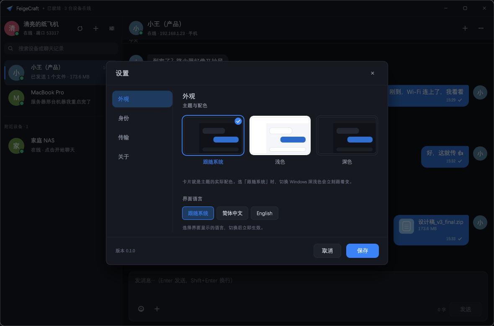
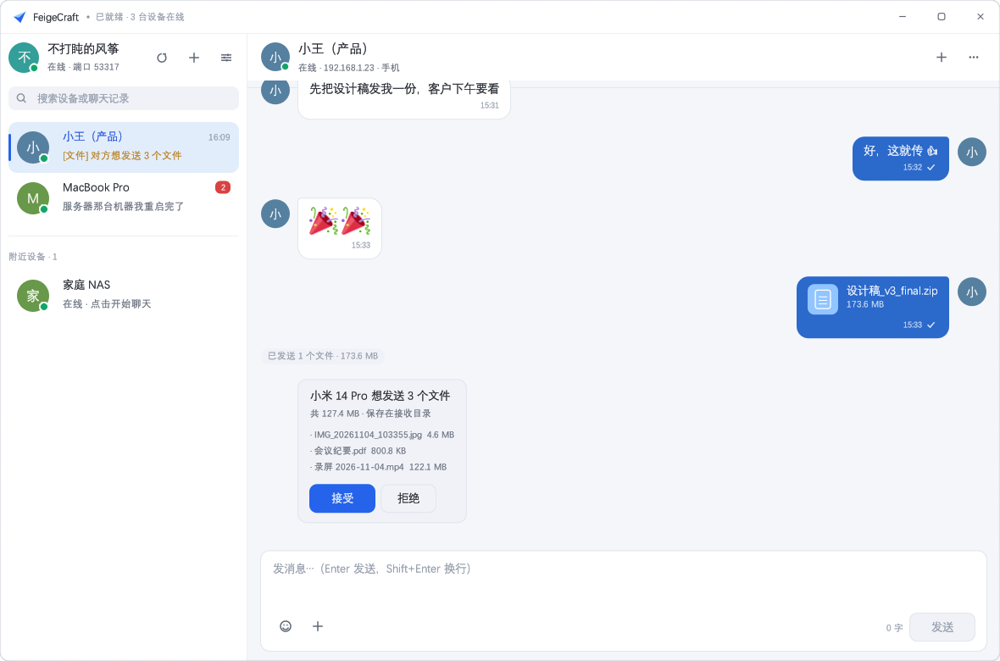
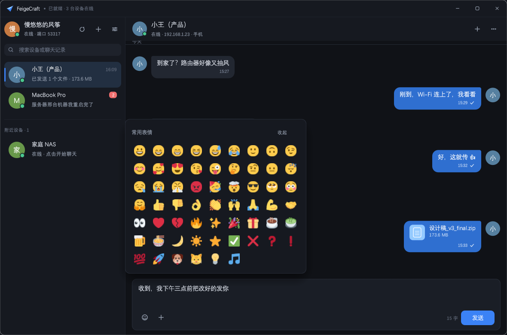
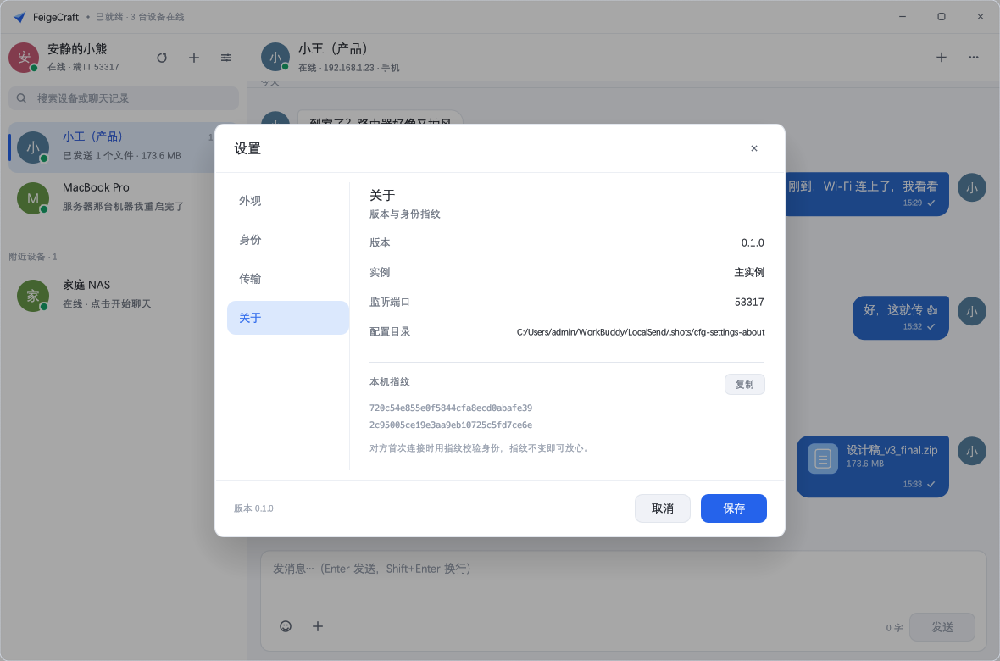
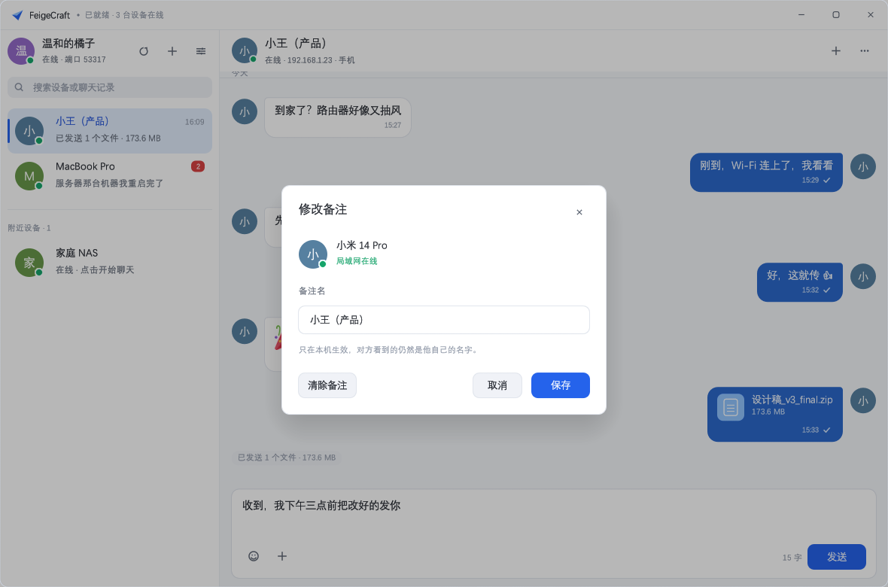
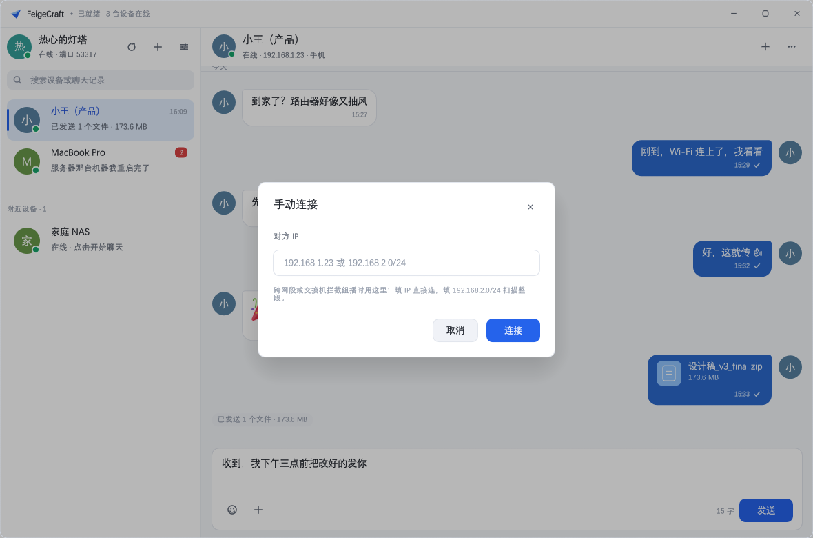
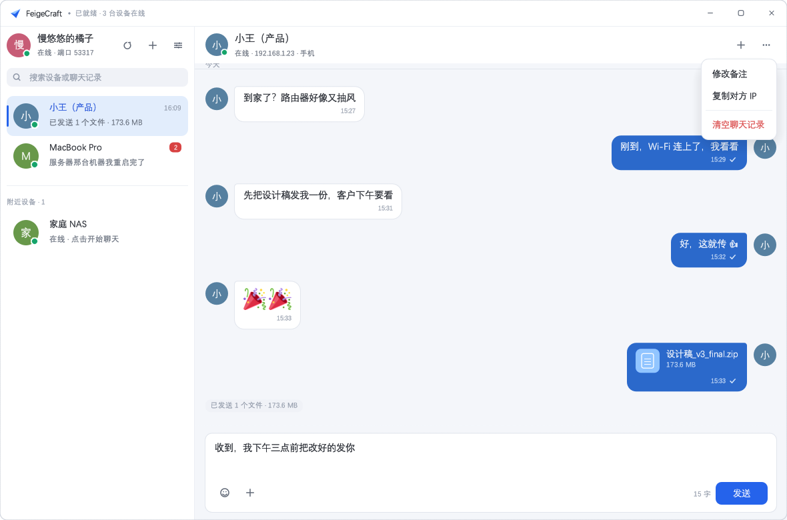
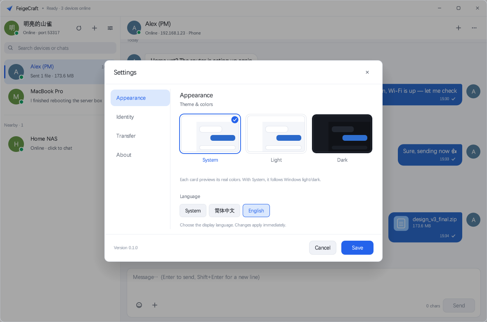

# FeigeCraft · LAN Chat & File Transfer (Rust)

> 🌐 **English** · [简体中文](README.zh-CN.md)

A LAN utility built from scratch in Rust: the **UI and interactions follow chat apps (conversation list / bubbles / emoji)**,
and the file-transfer protocol is **fully interoperable with [LocalSend](https://github.com/localsend/localsend)**.
Phones and computers on the same network can discover, chat with, and send files to each other by running either
LocalSend or FeigeCraft — all without going through any server.

- Pure Rust, a single executable, no runtime dependencies
- Desktop GUI ([egui](https://github.com/emilk/egui), OpenGL rendering, works on Windows / macOS / Linux)
- One executable, two forms: double-click for the window, subcommands for the command line (servers, Raspberry Pi, headless machines)
- **LAN chat**: text messages, emoji, persistent chat history, retry on failure
- **Auto discovery**: online as soon as it opens — no friend requests, no typing IPs; falls back to subnet scanning when multicast is blocked
- **Multi-interface**: wired / Wi-Fi / virtual adapters each bind their own multicast socket; scan a whole subnet with `192.168.2.0/24`
- **Random username**: a random "adjective + noun" on first launch ("Quiet Kite" in English, "安静的柠檬" in Chinese) — no more collisions of `DESKTOP-XXXX`
- **Multilingual**: Simplified Chinese / English, follows the system; switching in settings takes effect immediately, no restart
- **Nicknames**: rename yourself or others; nicknames are stored locally only. When set, the UI shows "original name (nickname)", and renames still match the same person
- **Background tray**: clicking × only hides to the tray; receiving and chat continue. New messages show a red dot on the icon and a system notification; double-click brings it back
- Transfer: HTTPS + self-signed certificate + **certificate pinning** (guards against LAN MITM)
- Streaming writes: writes a `.part` file then atomically renames; 10 GB files don't blow up memory
- Live progress, speed, cancel, reject, auto-accept

```
┌──────────────┐   multicast UDP 53317   ┌──────────────┐
│ FeigeCraft A │◀───────────────────────▶│  LocalSend   │
│              │                         │  or FeigeCraft│
│  HTTPS Server│◀──── files / chat ──────│      B       │
└──────────────┘   TLS + fingerprint     └──────────────┘
```

## Screenshots

| Dark (follows system by default) | Light |
| --- | --- |
|  |  |

| Settings panel | Incoming file request |
| --- | --- |
|  |  |

| Emoji panel (floating) | Settings dialog (About) |
| --- | --- |
|  |  |

| Edit nickname | Manual connect / subnet scan |
| --- | --- |
|  |  |

| "More" menu | English UI |
| --- | --- |
|  |  |

The layout deliberately mirrors mainstream chat apps: a conversation list on the left (avatar, name, last message,
time, unread count), a message stream on the right (peer bubbles on the left in gray, your bubbles on the right in blue,
avatars beside messages, date separators, timestamp and delivery status in the bubble's bottom-right), and an input
area at the bottom (emoji panel, attachments, Enter to send / Shift+Enter for a newline).
Incoming file requests no longer pop a modal that interrupts the chat — instead an "Accept / Reject" card is inserted into the stream.

**Emoji**: the panel uses Twemoji's color PNGs (CC-BY 4.0; assets and attribution in `crates/gui/assets/emoji/`).
Clicking the smiley opens a **floating** layer above the input box — it doesn't resize the input or squeeze the message
stream; click outside, press ESC, or click the smiley again to dismiss. egui's font stack can only get the outline layer
of emoji fonts (black-and-white), so emoji in bubbles are always drawn as textures: a message that is only emoji renders
as a big sticker; emoji mixed into text render at 17px and participate in per-character wrapping.

**Settings**: a self-drawn modal (left "Appearance / Identity / Transfer / About" navigation + right content).
The Appearance page previews real color schemes with three "mini chat window" cards — click to preview instantly, save to persist.

**Theme**: dark / light / follow-system (Settings → Appearance, defaults to follow-system, switching live with the OS).
The window title bar is self-drawn (`with_decorations(false)`) and follows the theme, so you never get a dark UI under a
bright white bar; drag, double-click-to-maximize, and edge snapping still go through the system. A borderless window in the
light theme can blur into adjacent white windows, so a 1px neutral-gray outline plus a 1px ultra-light inner shadow wraps
the outer edge (omitted automatically when maximized).

**Corner radius** uses three tiers: small controls 6px (menu items, icon buttons), regular blocks 8px (buttons, list rows,
bubbles), large blocks 10px (window, dialogs, dropdowns). The window itself uses Windows 11's native DWM rounding
(`DWMWA_WINDOW_CORNER_PREFERENCE`) — the system clips the whole window including the shadow, cleaner than faking rounded
corners in egui (whose clipping is rectangle-only).

**"More" menu** is self-drawn: items are transparent until hovered, dangerous actions (clear chat history) are in red;
the menu right-aligns under the button and sizes to the longest label in the current language, never overflowing the window.

**i18n**: `crates/gui/src/i18n.rs` uses **the Chinese source text as the key** (`tr("设置")`); entries missing from the
English table fall back to Chinese automatically — adding a string doesn't require pre-registering an id, and you'll never
see `settings.title` leak into the UI. Strings with variables are written as `tf(tr("Online · {}"), &[&ip])`, with arguments
ordered by the position of `{}`. The language preference is stored in `config.json`'s `language` (`system` / `zh-CN` / `en`);
`system` uses `GetUserDefaultUILanguage` (reads `LANG` on non-Windows). Switching redraws immediately, no restart. Adding a
language is just a new `Lang` variant plus a translation table in `i18n.rs`.

The app icon (paper plane) is generated by `scripts/make-icon.py`, and `crates/gui/build.rs` embeds it plus version info into
the exe via windres; the window icon uses the same PNG at runtime, so the taskbar, Alt-Tab, and Explorer are all consistent.

## Directory Structure

```
LocalSend/
├── Cargo.toml              # workspace
├── crates/
│   ├── core/               # protocol core library feigecraft-core
│   │   ├── model.rs        # data model (camelCase, aligned with LocalSend 2.x)
│   │   ├── tls.rs          # self-signed cert / fingerprint / certificate pinning
│   │   ├── discovery.rs    # multicast discovery (dual sockets) + subnet scan
│   │   ├── server.rs       # receiver: HTTPS + v2 REST API + chat endpoints
│   │   ├── client.rs       # sender: register → prepare → upload / send_chat
│   │   ├── chat.rs         # chat model, conversation threads, chats.json persistence
│   │   ├── state.rs        # shared runtime state, nicknames, event bus
│   │   ├── events.rs       # UI-facing event enum
│   │   ├── node.rs         # node assembly (server + discovery + chat library)
│   │   ├── util.rs         # filename sanitization / size formatting / subnet math
│   │   ├── config.rs       # config persistence
│   │   └── ../tests/e2e.rs # end-to-end tests: real TLS transfer / reject / chat
│   ├── cli/                # command-line capabilities (compiled as a lib, same exe)
│   └── gui/                # desktop feigecraft (egui/eframe)
│       ├── app.rs          # UI and interactions (conversation list / stream / input / dialogs)
│       ├── theme.rs        # design tokens (colors / radius), dark/light themes, fonts
│       ├── i18n.rs         # UI localization (Chinese source as key, fallback to Chinese)
│       ├── widgets.rs      # avatar, vector icons, bubbles, window buttons, etc.
│       ├── instance.rs     # single-instance mutex + control-port "wake" the window
│       ├── emoji.rs        # Twemoji texture loading and drawing
│       ├── build.rs        # embed icon and version info into the Windows exe
│       ├── assets/         # app icon + emoji assets (with licensing)
│       └── capture.rs      # built-in screenshot (for docs / regression acceptance)
├── scripts/                # make-icon.py / fetch-emoji.sh / bmp2png.py / build-installer.ps1
├── installer/              # Inno Setup script + Simplified Chinese language file
└── docs/                   # UI screenshots
```

## Installation

### Windows

No Rust required: download `FeigeCraft-<version>-setup.exe` from **Releases** and double-click.
(`dist/` is the local build output, already in `.gitignore`; the installer is uploaded to Releases at release time, not committed.)

- Bilingual wizard (Simplified Chinese / English), follows the system language by default; optional desktop shortcut and auto-start
- Installs to `C:\Program Files\FeigeCraft` by default (admin rights) and adds a firewall rule for the app;
  choose "install for me only" to install to `%LOCALAPPDATA%\Programs\FeigeCraft` without touching the firewall —
  in that case, if other devices can't find this machine, allow port 53317 (TCP+UDP) manually
- Uninstall from "Settings → Apps" or the Start menu; it only removes program files — config,
  chat history, and received files are left untouched

The installer is not code-signed; double-clicking a freshly built exe from `dist/` may trigger SmartScreen's
"Windows protected your PC" — click "More info → Run anyway".

#### Building the installer yourself

```powershell
# One-time: install Inno Setup 6
winget install --id JRSoftware.InnoSetup --exact

# Each release
powershell -ExecutionPolicy Bypass -File scripts/build-installer.ps1
```

The script reads the version from `Cargo.toml` → `cargo build --release` → runs ISCC to compile
`installer/feigecraft.iss`, producing `dist/FeigeCraft-<version>-setup.exe`. Add `-SkipBuild` to skip
compilation and package an existing exe.

### Linux

Download `feigecraft_<version>_amd64.deb` from **Releases** and install:

```bash
sudo dpkg -i feigecraft_<version>_amd64.deb
```

This installs `feigecraft` to `/usr/bin`, adds a desktop menu entry, and installs the app icon.
It depends on `libgtk-3-0` and `libssl3`, which are present on most desktop distros.

### macOS

Download `feigecraft-macos-<arch>.dmg` from **Releases** (`arm64` for Apple Silicon, `x64` for Intel),
open it, and drag **FeigeCraft** into **Applications**.

> The binaries are not notarized/signed. On first launch macOS may block it — right-click the app and
> choose "Open", then confirm in the dialog (or run `xattr -dr com.apple.quarantine /Applications/FeigeCraft.app`).

## Quick Start

Requires Rust 1.78+:

```bash
cargo run -p feigecraft-gui --release
```

The build produces a **single** `target/release/feigecraft` (`feigecraft.exe` on Windows):
it's both a desktop app and a command-line tool. With a subcommand it doesn't open a window — it runs and exits.

### Command Line

```bash
feigecraft discover                              # scan the LAN for devices
feigecraft send ./photo.jpg --to "Pixel Phone"   # send a file (--to accepts alias / IP / fingerprint)
feigecraft send ./movie.mp4 --to 192.168.1.23    # specify the IP directly, skip discovery
feigecraft chat "Got it" --to "Pixel Phone"      # send a chat message
feigecraft info                                  # local alias, port, certificate fingerprint
```

With cargo: `cargo run -p feigecraft-gui --release -- <subcommand>`.

## Background Running

Two modes, pick by scenario:

**① Hide to background**: clicking × no longer quits — it just hides the window while receiving and chat continue.
Run the program again (or click the Start menu icon) brings the window back, **without** launching a second instance.
Toggle in "Settings → Transfer → On close", on by default; turn it off and × quits directly.

When hidden, a tray icon remains at the bottom-right of the taskbar: left-click to restore the window, right-click for
"Show window / Quit". On a new message or file request the icon shows a red dot, the hover tooltip carries the unread
count, and a system notification pops when not in the foreground. The icon is removed cleanly on exit (no ghost icon),
and is restored automatically after Explorer restarts.

**② Fully headless**: for servers, auto-start, and machines where you don't want a window.

```bash
feigecraft serve                                   # foreground, Ctrl+C to quit
feigecraft serve --alias home-nas --dir /data/incoming --port 53317
```

`serve` auto-accepts all files by default; add `--ask` to prompt for each request in the terminal.
If the port is taken (e.g. the GUI is already running) it shifts to the next available port rather than failing.

Auto-start registers `feigecraft.exe --background`: the process runs in the background at boot without showing the
window; click the icon to bring up the UI.

### Multiple instances on one machine (testing against yourself)

By default there is **only one window at a time**: running the program again just brings the existing window to the
front (this is also how "return after close" works). To actually open a second one, add `--new` or `--instance 2`:

```bash
./target/release/feigecraft.exe                  # first: primary instance, port 53317
./target/release/feigecraft.exe --new            # second: becomes "instance 2", port 53318
./target/release/feigecraft.exe --instance 3     # specify the number
```

The second process detects on startup that "instance 1's number is taken", so it automatically:

- picks a new instance number and moves the config dir to `<config-dir>/instance-N` (certificates, chat history, and
  nicknames are independent, so **fingerprints differ** and each side sees the other as a separate device);
- appends a suffix to the username (e.g. `Quiet Kite-1`) and suffixes the download dir, avoiding name collisions;
- sets the listening port to `53317 + N` (instance 2 uses 53318, instance 3 uses 53319), no longer competing for 53317,
  and broadcasts the updated `info.port`, so peers always connect to this instance. Instance 0 keeps 53317, preserving
  LocalSend interop.

You can also specify explicitly:

```bash
./target/release/feigecraft.exe --instance 3 --alias test --port 53400
./target/release/feigecraft.exe --config-dir ./portable-b
```

The instance number is locked by holding the local port `127.0.0.1:53300+N`, released on exit — no lock file is left behind.

### Using the GUI

1. On launch, devices on the same subnet appear in the left column automatically (the peer needs LocalSend or FeigeCraft running), no friend requests needed.
2. Click a conversation → type in the input box, Enter to send; click the smiley for emoji; `Shift + Enter` for a newline.
3. Click 📎 or drag files into the window → a file bubble is sent; the peer sees an "Accept / Reject" card.
4. The "⋯" at the top-right of a conversation lets you edit the nickname (local only), copy the peer's IP, or clear history.
5. Settings lets you change the username, device type, save directory, auto-accept, and **appearance (follow-system / light / dark)**.

## Protocol mapping with LocalSend

| Endpoint | Direction | Description |
| --- | --- | --- |
| `POST /api/localsend/v2/register` | sender → receiver | exchange device info, returns alias and fingerprint |
| `POST /api/localsend/v2/prepare-upload` | sender → receiver | submit the file list; receiver confirms and returns `sessionId` and a `token` per file |
| `POST /api/localsend/v2/upload?sessionId=&fileId=&token=` | sender → receiver | raw-stream upload of a single file (also accepts the legacy header form) |
| `POST /api/localsend/v2/cancel?sessionId=` | both | cancel the session |
| `GET /api/localsend/v2/info` | any | returns device info (also used by subnet scanning) |
| `POST /api/feigecraft/chat` | both | **chat extension** (see below); LocalSend returns 404, file transfer is unaffected |
| UDP multicast `224.0.0.167:53317` | bidirectional | JSON device-info broadcast; `announce=true` means an active broadcast |

### Chat extension protocol

Reuses the same HTTPS channel and certificate-fingerprint check — no extra port:

```jsonc
POST /api/feigecraft/chat
{
  "info": { "alias": "My PC", "version": "2.1", "port": 53317,
            "protocol": "https", "fingerprint": "…", "deviceModel": "windows" },
  "messages": [
    { "id": "7a906db1-…", "text": "Got it, thanks!", "at": 1793771855221 }
  ]
}
```

- Conversation identity uses the **device fingerprint**, not the alias (aliases can change and collide), so renaming never loses history.
- Messages are **persisted locally before delivery**: even if the peer is offline, the message stays in a bubble above the input with a "failed" mark, clickable to retry.
- When the peer is stock LocalSend, it returns 404 and the UI shows "the peer doesn't support chat (file transfer only)" — file transfer still works.
- Each conversation keeps at most 400 messages (`MAX_MESSAGES_PER_PEER`), so `chats.json` never grows unboundedly.

Implementation details:

- The device fingerprint is the SHA-256 of the self-signed certificate's DER; the cert is generated and persisted on first launch, so the **fingerprint is stable across restarts**.
- The client doesn't use the system root store — it **trusts only the fingerprint the peer broadcast**; a mismatch aborts the TLS handshake.
- The client forces `no_proxy()`: LAN direct connections must never go through a system proxy, or users with a VPN/proxy would all fail.
- Uploads write to a `.part` temp file first, then `rename` on success; on failure/cancel the partial file is removed.
- Same-name files are renamed to `name (1).ext`; filenames are sanitized against path traversal and illegal characters.
- When the port is taken (e.g. LocalSend is also installed) it shifts to the next available port and broadcasts the new one.
- **Discovery uses dual sockets**: one ephemeral port is dedicated to sending broadcasts (peer replies come back unicast to this port, guaranteeing receipt), while another tries to hold 53317 to receive others' periodic broadcasts. So even if another LocalSend instance already holds 53317, discovery still works (on Windows, when multiple processes bind the same UDP port, multicast packets are delivered to only one of them).
- If no device is found 4 seconds after launch, it automatically does a local-subnet HTTP scan as a fallback (useful when multicast is isolated by switches/APs).

## Tests

```bash
cargo test --workspace                    # 15 unit tests + 3 end-to-end tests + 1 doc test
cargo clippy --workspace --all-targets    # zero warnings
```

The end-to-end tests spin up two real nodes in a temp dir (one sender, one receiver), run the full
`register → prepare-upload → upload` flow, and verify the on-disk contents; the chat case sends a real message and
asserts "sender marks delivered / receiver emits an event and persists / the conversation is attributed to the right
fingerprint / the alias is recorded". No external services required.

## Config and data locations

| Platform | Path |
| --- | --- |
| Windows | `%APPDATA%\FeigeCraft\` |
| macOS | `~/Library/Application Support/FeigeCraft/` |
| Linux | `~/.config/FeigeCraft/` |

Contents:

| File | Purpose |
| --- | --- |
| `config.json` | username (random on first launch, editable in settings), device type, port, download dir, auto-accept, **nickname table**, theme preference (`theme`) |
| `cert.der` / `key.der` | self-signed certificate and private key (determine the device fingerprint) |
| `chats.json` | chat history (grouped by peer fingerprint) |

With multiple instances, the 2nd and later instances use `<config-dir>/instance-N/` with the same structure.

Default download dir: a `FeigeCraft` subdirectory of the system Downloads folder (`FeigeCraft-N` for extra instances), editable in settings.

Environment variables:

| Variable | Purpose |
| --- | --- |
| `FEIGECRAFT_CONFIG_DIR` | set the config dir (portable mode / multi-instance testing) |
| `FEIGECRAFT_KEEP_CONSOLE` | keep the console in window mode, for reading logs |
| `FEIGECRAFT_FONT` | specify a Chinese font file |
| `FEIGECRAFT_LOG` | log level (e.g. `debug`) |
| `FEIGECRAFT_THEME` | temporarily override the theme (`system` / `light` / `dark`), doesn't affect the saved preference |
| `FEIGECRAFT_LANG` | temporarily override the UI language (`zh-CN` / `en`), doesn't affect the saved preference |
| `FEIGECRAFT_SCREENSHOT` | render one frame, save as BMP, then exit (for docs / regression acceptance) |
| `FEIGECRAFT_UI_DEMO` | render the UI with fake data (`1` / `incoming` / `settings` / `settings-identity` / `settings-transfer` / `settings-about` / `emoji` / `remark` / `connect` / `menu`), for screenshots and design review |

## Cross-platform build

```bash
cargo build --release            # current platform
cargo build --release --target x86_64-pc-windows-gnu     # cross-compile example
```

- **Windows**: no extra dependencies (MSVC or GNU toolchain both work).
- **macOS**: `xcode-select --install`.
- **Linux**: needs X11/Wayland dev libraries
  `sudo apt install libxkbcommon-dev libgtk-3-dev libxcb-render0-dev libxcb-shape0-dev \
   libxcb-xfixes0-dev libssl-dev pkg-config` (the file dialog depends on GTK).
- Chinese fonts: auto-detected from the system (`Deng.ttf` / `simhei.ttf` / Noto Sans SC, etc.),
  or set `FEIGECRAFT_FONT=/path/to/font.ttf`.

### Firewall

On first run Windows pops "Allow access to the network" — check **Private networks**. If it doesn't appear and no devices
are found, allow it manually:

```powershell
New-NetFirewallRule -DisplayName "FeigeCraft" -Direction Inbound -Protocol TCP -LocalPort 53317 -Action Allow
New-NetFirewallRule -DisplayName "FeigeCraft-UDP" -Direction Inbound -Protocol UDP -LocalPort 53317 -Action Allow
```

Linux: `sudo ufw allow 53317/tcp && sudo ufw allow 53317/udp`.

Extra instances (`53318`–`53324`) are only for local self-testing; same-machine traffic doesn't traverse the firewall,
so no extra rule is needed. To connect to the Nth instance across machines, allow the corresponding TCP port too.

## Known limitations / future work

- Chat doesn't inline-preview image/voice messages (images go through the file channel; tap them in the bubble to open after receiving).
- No group chat: LocalSend's discovery model is peer-to-peer; group chat would need an extra machine to relay.
- Doesn't implement LocalSend v2.2's optional `sha256` check and file preview thumbnails (fields left empty; the peer still receives normally).
- No resumable transfers (LocalSend doesn't support them either).
- Sending a directory flattens subdirectory structure to `dir_filename`, avoiding conflicts with LocalSend's filename semantics.
- Multicast is isolated on some enterprise networks / guest Wi-Fi, and routers generally don't forward 224.0.0.167 across subnets:
  same-subnet works via each interface's multicast; cross-subnet use "Manual connect" with an IP, or scan a whole subnet with `192.168.2.0/24`.
- The receiver currently has no rate limiting or blocklist (LocalSend has pin/block; could extend `server.rs` as needed).
- The installer isn't code-signed (requires your own certificate); SmartScreen will show "unknown publisher" on distribution.

## License

MIT — see [LICENSE](LICENSE). The protocol design is from [LocalSend](https://github.com/localsend/localsend)
(MIT/Apache-2.0); this project is an independent implementation, its code unrelated to theirs.

Emoji assets are from [Twemoji](https://github.com/twitter/twemoji) 14.0.2, licensed **CC-BY 4.0**
(Copyright 2020 Twitter, Inc and other contributors), see `crates/gui/assets/emoji/ATTRIBUTION.md`;
re-fetch with `scripts/fetch-emoji.sh`.
