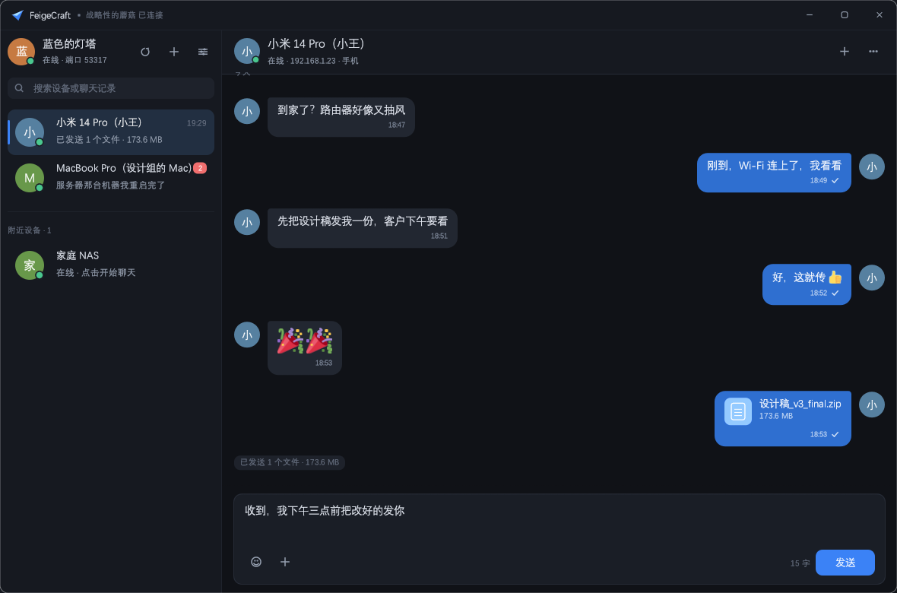
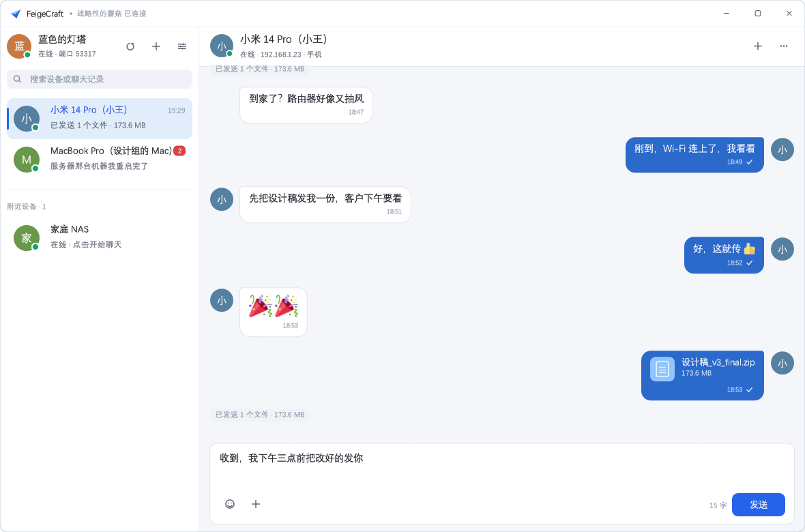
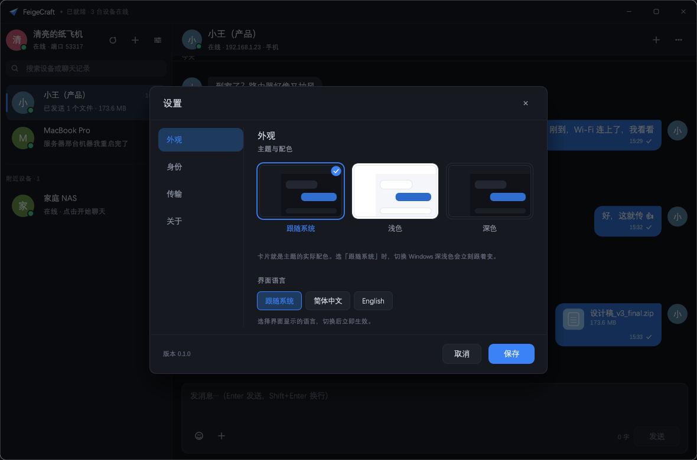
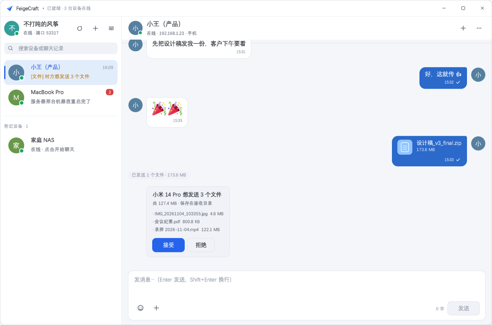
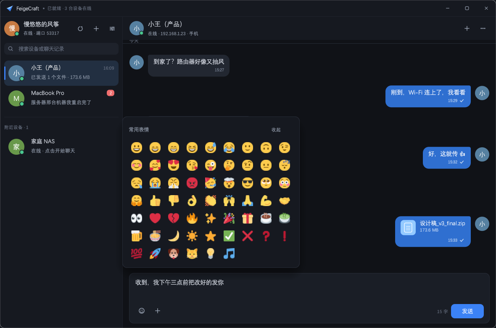
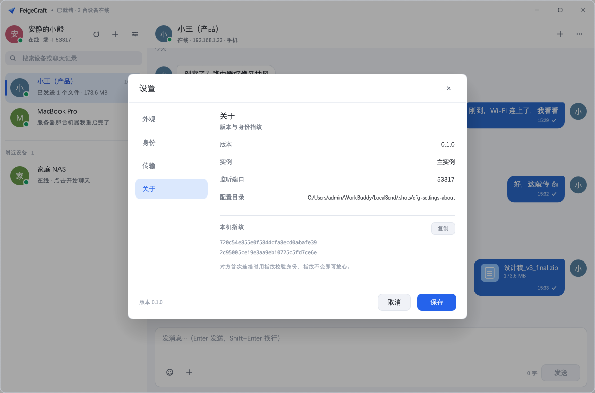
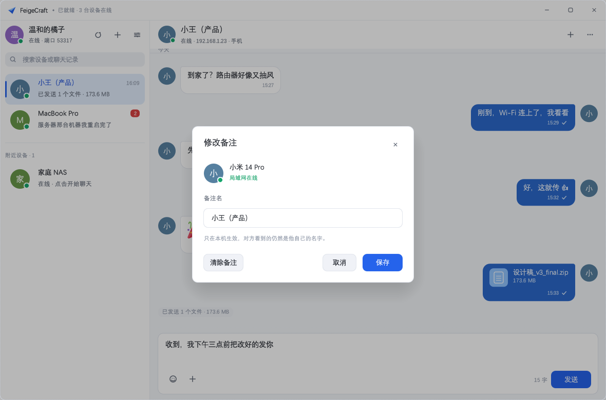
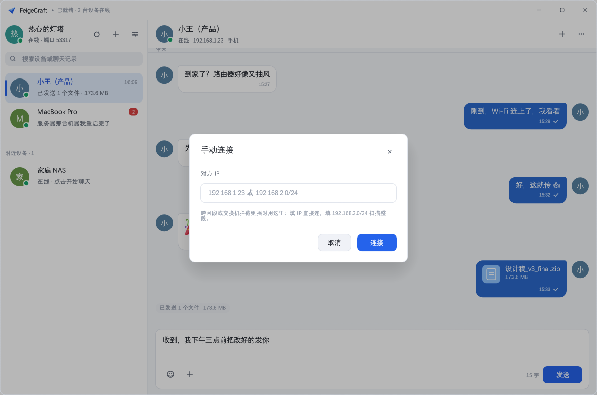
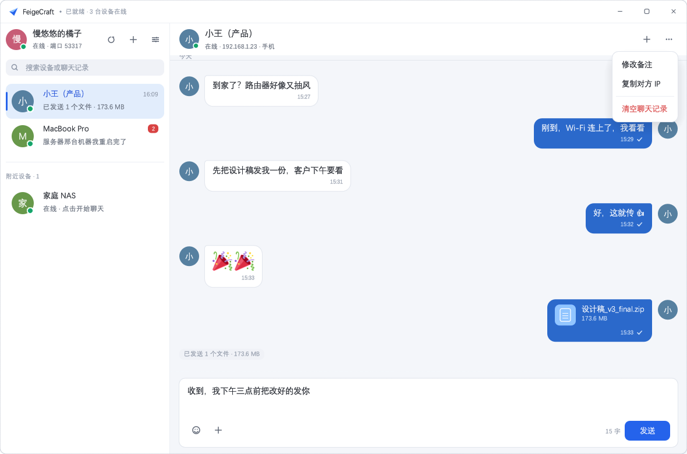
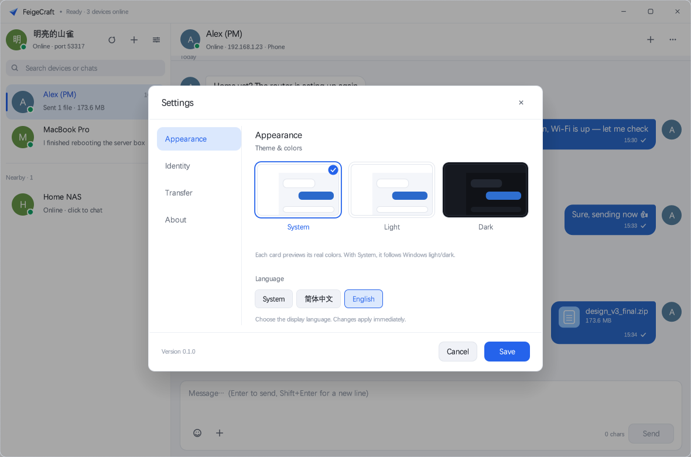

# FeigeCraft · 局域网聊天与快传（Rust）

> 🌐 [English](README.md) · **简体中文**


用 Rust 从零实现的局域网工具：**界面与交互按聊天软件来做（会话列表 / 气泡 / 表情）**，
文件传输协议**与 [LocalSend](https://github.com/localsend/localsend) 完全互通**。
同一网段内的手机、电脑打开 LocalSend 或 FeigeCraft，就能互相发现、聊天、互发文件，全程不经过任何服务器。

- 纯 Rust 实现，单个可执行文件，无运行时依赖
- 桌面 GUI（[egui](https://github.com/emilk/egui)，OpenGL 渲染，Windows / macOS / Linux 通用）
- 一个 exe 两种形态：双击是窗口，带子命令就是命令行（服务器、树莓派、无桌面环境都能跑）
- **局域网聊天**：文字消息、表情、聊天记录本地持久化、失败可重发
- **自动发现**：打开就在线，无需添加好友、无需输 IP；组播被屏蔽时可退化为子网扫描
- **多网段**：有线 / Wi-Fi / 虚拟网卡各绑一个组播套接字，一个网段都不漏；跨网段可填 `192.168.2.0/24` 扫整段
- **随机用户名**：首次启动随机取一个「形容词 + 名词」（中文界面如「安静的柠檬」，
  英文界面如「Quiet Kite」），避免一堆 `DESKTOP-XXXX` 撞名
- **多语言**：简体中文 / English，可跟随系统；设置里切换即时生效，不用重启
- **备注名**：自己起名、给别人改备注，备注只存在本机；设了备注后界面显示为
  「原昵称（备注名）」，对方改名也对得上号
- **后台常驻**：点 × 只收进托盘，接收与聊天照常；有新消息时图标带红点并弹系统通知，再双击即回前台
- 传输：HTTPS + 自签名证书 + **证书指纹固定**（防局域网中间人）
- 流式落盘：边传边写，先写 `.part` 再原子改名，10 GB 文件也不吃内存
- 实时进度、速度、取消、拒绝、自动接受

```
┌──────────────┐   组播 UDP 53317     ┌──────────────┐
│ FeigeCraft A │◀────────────────────▶│  LocalSend   │
│              │                      │ 或 FeigeCraft│
│  HTTPS Server│◀──── 文件 / 聊天 ────│      B       │
└──────────────┘   TLS + 指纹校验      └──────────────┘
```

## 界面

| 深色（默认跟随系统） | 浅色 |
| --- | --- |
|  |  |

| 设置面板 | 收到文件请求 |
| --- | --- |
|  |  |

| 表情面板（浮层） | 设置弹窗（关于） |
| --- | --- |
|  |  |

| 修改备注 | 手动连接 / 跨网段扫描 |
| --- | --- |
|  |  |

| 「更多」菜单 | English 界面 |
| --- | --- |
|  |  |

布局刻意贴齐主流聊天软件：左侧会话列表（头像、名字、最后一条消息、时间、未读数），
右侧消息流（对方左侧灰气泡、自己右侧蓝气泡、消息旁头像、日期分隔线、气泡内右下角的时间与送达状态），
底部输入区（表情面板、附件、回车发送 / Shift+回车换行）。
别人给你发文件时不再弹模态框打断聊天，而是在消息流里插一张「接受 / 拒绝」卡片。

**表情**：面板里是 Twemoji 的彩色 PNG（CC-BY 4.0，素材与署名见 `crates/gui/assets/emoji/`）。
点笑脸后是一块**浮层**贴着输入框上沿弹出，不改变输入区高度、不挤压消息流；
点外面、按 ESC 或再点一次笑脸即可收起。egui 的字体栈只能取到 emoji 字体的轮廓层（黑白），
所以气泡里的表情一律走贴图：整条消息只有表情时贴成大表情；夹在文字中间时按 17px 贴图、
参与逐字换行（表情字形的墨迹常比度量宽度宽，交给字体会被气泡边缘裁掉）。

**设置**：自绘模态框（左侧「外观 / 身份 / 传输 / 关于」导航 + 右侧内容），
外观页用三张「迷你聊天窗口」预览卡直接展示真实配色，点一下即时预览，保存才落盘。

**主题**：深色 / 浅色 / 跟随系统三选一（设置 → 外观，默认跟随系统，跟随系统时随操作系统实时切换）。
窗口标题栏是自绘的（`with_decorations(false)`），跟着主题一起变色，不会出现深色界面顶着一根亮白条的情况；
拖动、双击最大化、贴边分屏仍交给系统处理。无边框窗口在浅色主题下容易和旁边的白窗口糊成一片，
所以最外沿补了一圈 1px 中性灰描边 + 1px 极淡内阴影（最大化时自动省略）。

**圆角**统一成三档：小控件 6px（菜单项、图标按钮）、常规块 8px（按钮、列表行、气泡）、
大块 10px（窗口、弹窗、下拉菜单）。窗口本身用 Windows 11 的 DWM 原生圆角
（`DWMWA_WINDOW_CORNER_PREFERENCE`），系统会把整个窗口连同阴影一起裁圆，
比在 egui 里画假圆角干净——egui 的裁剪只有矩形，自己画只能"糊"四个角。

**更多菜单**是自绘的：菜单项平时透明，只在 hover 时出色块，危险操作（清空聊天记录）用红字；
菜单右对齐到按钮下方，宽度按当前语言最长的文案实测，不会伸出窗口被裁掉。

**多语言**：`crates/gui/src/i18n.rs` 里用**中文原文当 key**（`tr("设置")`），英文表里没有的条目
自动回退到中文——新增一处文案不必先注册 id，也不会出现界面上冒出 `settings.title` 这种事。
带变量的句子写成 `tf(tr("在线 · {}"), &[&ip])`，参数按 `{}` 出现顺序排列。
语言偏好存 `config.json` 的 `language`（`system` / `zh-CN` / `en`），`system` 走
`GetUserDefaultUILanguage`（非 Windows 读 `LANG`）判定；切换后立即重绘，不需要重启。
新增语言只要在 `i18n.rs` 里加一个 `Lang` 变体、一张译文表。

应用图标（纸飞机）用 `scripts/make-icon.py` 生成，`crates/gui/build.rs` 通过 windres 把它和版本信息
一起嵌进 exe；窗口图标则用同一张 PNG 在运行时设置，任务栏、Alt-Tab、资源管理器三处一致。

## 目录结构

```
LocalSend/
├── Cargo.toml              # workspace
├── crates/
│   ├── core/               # 协议核心库 feigecraft-core
│   │   ├── model.rs        # 数据模型（camelCase，对齐 LocalSend 2.x）
│   │   ├── tls.rs          # 自签名证书 / 指纹 / 证书 pinning 校验
│   │   ├── discovery.rs    # 组播发现（双套接字）+ 子网扫描
│   │   ├── server.rs       # 接收端：HTTPS + v2 REST API + 聊天接口
│   │   ├── client.rs       # 发送端：register → prepare → upload / send_chat
│   │   ├── chat.rs         # 聊天模型、会话线程、chats.json 持久化
│   │   ├── state.rs        # 共享运行时状态、备注名、事件总线
│   │   ├── events.rs       # 前端可见的事件枚举
│   │   ├── node.rs         # 组装节点（服务端 + 发现 + 聊天库）
│   │   ├── util.rs         # 文件名清洗 / 体积格式化 / 网段计算
│   │   ├── config.rs       # 配置持久化
│   │   └── ../tests/e2e.rs # 真实 TLS 收发 / 拒绝 / 聊天的端到端测试
│   ├── cli/                # 命令行能力（编成库，挂在同一个 exe 上）
│   └── gui/                # 桌面端 feigecraft（egui/eframe）
│       ├── app.rs          # 界面与交互（会话列表 / 消息流 / 输入区 / 弹窗）
│       ├── theme.rs        # 设计令牌（配色 / 圆角）、深/浅两套主题、字体
│       ├── i18n.rs         # 界面多语言（中文原文作 key，缺译文回退中文）
│       ├── widgets.rs      # 头像、矢量图标、气泡、窗口按钮等组件
│       ├── instance.rs     # 单实例互斥 + 控制端口「叫醒」窗口
│       ├── emoji.rs        # Twemoji 贴图加载与绘制
│       ├── build.rs        # 把图标与版本信息嵌入 Windows exe
│       ├── assets/         # 应用图标 + 表情素材（含授权说明）
│       └── capture.rs      # 内建截图（文档 / 回归验收用）
├── scripts/                # make-icon.py / fetch-emoji.sh / bmp2png.py / build-installer.ps1
├── installer/              # Inno Setup 脚本 + 简体中文语言文件
└── docs/                   # 界面截图
```

## 安装（Windows）

不需要装 Rust：从 **Releases** 下载 `FeigeCraft-<版本>-setup.exe` 双击即可。
（`dist/` 是本地产物目录，已在 `.gitignore` 里，安装包不进仓库，由发版时上传到 Releases。）

- 向导中英双语，默认跟随系统语言；可选桌面快捷方式、开机自启
- 默认装到 `C:\Program Files\FeigeCraft`（管理员权限），并顺手在防火墙里放行本程序；
  选「仅为我安装」则装到 `%LOCALAPPDATA%\Programs\FeigeCraft`，不改防火墙，
  此时若别的设备发现不到本机，手动放行 53317（TCP+UDP）即可
- 卸载入口在「设置 → 应用」和开始菜单里；只删程序文件，配置、
  聊天记录和收到的文件都不动

安装包没有代码签名，`dist/` 里直接双击新构建的 exe 时，SmartScreen 可能提示
「Windows 已保护你的电脑」，点「更多信息 → 仍要运行」即可。

### 自己构建安装包

```powershell
# 只需一次：装 Inno Setup 6
winget install --id JRSoftware.InnoSetup --exact

# 每次出包
powershell -ExecutionPolicy Bypass -File scripts/build-installer.ps1
```

脚本会从 `Cargo.toml` 读版本号 → `cargo build --release` →
调 ISCC 编译 `installer/feigecraft.iss`，产物是 `dist/FeigeCraft-<版本>-setup.exe`。
加 `-SkipBuild` 可以跳过编译、直接用现成的 exe 打包。

## 快速开始

需要 Rust 1.78+：

```bash
cargo run -p feigecraft-gui --release
```

编译产物只有**一个** `target/release/feigecraft`（Windows 下是 `feigecraft.exe`）：
它既是桌面程序，也是命令行工具。带子命令时不弹窗口，跑完直接退出。

### 命令行

```bash
feigecraft discover                              # 扫一遍局域网设备
feigecraft send ./photo.jpg --to "小米手机"       # 发送文件（--to 可用别名 / IP / 指纹）
feigecraft send ./movie.mp4 --to 192.168.1.23    # 直接指定 IP，跳过发现
feigecraft chat "文件收到了" --to "小米手机"       # 发一条聊天消息
feigecraft info                                  # 本机别名、端口、证书指纹
```

用 cargo 跑则写成 `cargo run -p feigecraft-gui --release -- <子命令>`。

## 后台运行

两种方式，按场景挑：

**① 窗口收进后台**：点 × 不再退出程序，只是把窗口藏起来，接收和聊天照常工作。
再双击一次程序（或开始菜单图标）窗口就回来，**不会**开出第二个实例。
开关在「设置 → 传输 → 关闭窗口时」，默认开着；关掉它，× 就恢复成直接退出。

窗口收起后任务栏右下角（托盘）仍有图标：左键点一下唤回窗口，右键菜单可以
「显示主窗口 / 退出」。收到新消息或文件请求时，图标右下角会出现红点、
悬停提示带未读数，不在前台时还会弹一条系统通知气泡。
退出程序时会自动摘掉图标，不留「幽灵图标」；资源管理器重启后图标也会自动补回。

**② 完全无界面**：适合服务器、开机自启、不想留窗口的机器。

```bash
feigecraft serve                                   # 前台跑，Ctrl+C 退出
feigecraft serve --alias 家庭NAS --dir D:\收件 --port 53317
```

`serve` 默认自动接受所有文件；加 `--ask` 改成每个请求都在终端问一句。
端口被占用时（比如窗口版已经开着）会自动顺延，不会启动失败。

开机自启注册的是 `feigecraft.exe --background`：开机后进程在后台跑、窗口不露面，
点图标才进前台。

### 同一台机器开多个实例（自己跟自己测）

默认情况下**同一时刻只有一个窗口**：再运行一次程序只会把已经开着的窗口叫到前台
（这也是「关闭后还能回来」的实现方式）。真要开第二个，加 `--new` 或 `--instance 2`：

```bash
./target/release/feigecraft.exe                  # 第一个：主实例，端口 53317
./target/release/feigecraft.exe --new            # 第二个：自动变成「实例 2」，端口 53318
./target/release/feigecraft.exe --instance 3     # 指定编号
```

第二个进程会在启动时发现「实例 1 的编号已被占用」，于是自动：

- 换一个实例编号，把配置目录挪到 `<配置目录>/instance-N`（证书、聊天记录、备注互不干扰，因此**指纹不同**，双方能互相看见对方是另一台设备）；
- 用户名自动加后缀（如 `安静的柠檬-1`），下载目录也带上实例后缀，避免同名文件互相覆盖；
- 监听端口直接定为 `53317 + N`（实例 2 用 53318、实例 3 用 53319），不再和 0 号实例抢 53317，
  广播出去的 `info.port` 也同步改成自己的端口，对方连的就一定是这个实例。0 号实例保持 53317，不影响 LocalSend 互操作。

也可以显式指定：

```bash
./target/release/feigecraft.exe --instance 3 --alias 测试机 --port 53400
./target/release/feigecraft.exe --config-dir ./portable-b
```

实例编号靠「占住 `127.0.0.1:53300+N` 这个本地端口」来互斥，进程退出即释放，不会留下锁文件。

### 图形界面怎么用

1. 打开后左栏会自动出现同网段设备（对方需打开 LocalSend 或 FeigeCraft），无需加好友。
2. 点会话 → 底部输入框打字，回车发送；点笑脸选表情；`Shift + Enter` 换行。
3. 点 📎 或把文件拖进窗口 → 生成文件气泡发送，对方收到「接受 / 拒绝」卡片。
4. 会话右上角「⋯」可改备注（只存本机）、复制对方 IP、清空聊天记录。
5. 设置里可改用户名、设备类型、保存目录、是否自动接受文件，以及**外观（跟随系统 / 浅色 / 深色）**。

## 与 LocalSend 的协议对应关系

| 接口 | 方向 | 说明 |
| --- | --- | --- |
| `POST /api/localsend/v2/register` | 发送方 → 接收方 | 交换设备信息，返回别名与指纹 |
| `POST /api/localsend/v2/prepare-upload` | 发送方 → 接收方 | 提交文件清单，接收方确认后返回 `sessionId` 与每个文件的 `token` |
| `POST /api/localsend/v2/upload?sessionId=&fileId=&token=` | 发送方 → 接收方 | 裸流上传单个文件（同时兼容旧版 header 传参） |
| `POST /api/localsend/v2/cancel?sessionId=` | 双方 | 取消会话 |
| `GET /api/localsend/v2/info` | 任意 | 返回设备信息（子网扫描也用它） |
| `POST /api/feigecraft/chat` | 双方 | **聊天扩展**（见下），LocalSend 会返回 404，此时文件功能不受影响 |
| UDP 组播 `224.0.0.167:53317` | 双向 | JSON 广播设备信息，`announce=true` 表示主动广播 |

### 聊天扩展协议

复用同一条 HTTPS 通道和同一套证书指纹校验，不额外开端口：

```jsonc
POST /api/feigecraft/chat
{
  "info": { "alias": "我的电脑", "version": "2.1", "port": 53317,
            "protocol": "https", "fingerprint": "…", "deviceModel": "windows" },
  "messages": [
    { "id": "7a906db1-…", "text": "文件收到了，谢谢！", "at": 1793771855221 }
  ]
}
```

- 会话身份用**设备指纹**而不是别名（别名可以改、可以重名），所以改用户名不会丢聊天记录。
- 消息**先本地落库再投递**：即使对方离线，消息也留在输入区上方的气泡里并标记「失败」，点一下可重发。
- 对方是原版 LocalSend 时返回 404，界面提示「对方版本不支持聊天（仅支持收发文件）」，文件传输照常。
- 每个会话最多保留 400 条消息（`MAX_MESSAGES_PER_PEER`），避免 `chats.json` 无限膨胀。

实现细节：

- 设备指纹 = 自签证书 DER 的 SHA-256，证书首次启动生成并持久化在配置目录，**重启后指纹不变**。
- 客户端不使用系统根证书，而是**只信任对方广播出来的那个指纹**；指纹不匹配直接中断 TLS 握手。
- 客户端强制 `no_proxy()`：局域网直连绝不能走系统代理，否则开了 VPN / 代理软件的用户会全部失败。
- 上传时先落 `.part` 临时文件，成功后 `rename`，失败/取消则删除，不会留下半截文件。
- 同名文件自动改名为 `name (1).ext`，文件名做了路径穿越与非法字符清洗。
- 端口被占用（比如同时装了 LocalSend）时会自动顺延到下一个可用端口并广播新端口。
- **发现用双套接字**：一个临时端口专门负责发广播（对方的回包会单播回到这个端口，保证一定能收到），
  另一个尽力占住 53317 收别人主动发出的周期性广播。这样即使本机 53317 已被另一个 LocalSend 实例占用，
  发现依然可用（Windows 上多进程重复绑定同一 UDP 端口时，组播包只会投递给其中一个进程）。
- 启动 4 秒后若仍没发现任何设备，自动做一次本机子网 HTTP 扫描兜底（组播被交换机/AP 隔离时有用）。

## 测试

```bash
cargo test --workspace                    # 15 个单元测试 + 3 个端到端测试 + 1 个文档测试
cargo clippy --workspace --all-targets    # 零警告
```

端到端测试会在临时目录里起两个真实节点（一个发送端、一个接收端），走完整的
`register → prepare-upload → upload` 流程并校验落盘内容；聊天用例则发一条真实消息，
断言「发送端标记已送达 / 接收端收到事件并入库 / 会话归属到正确指纹 / 别名被记录」。
不依赖外部服务。

## 配置与数据位置

| 平台 | 路径 |
| --- | --- |
| Windows | `%APPDATA%\FeigeCraft\` |
| macOS | `~/Library/Application Support/FeigeCraft/` |
| Linux | `~/.config/FeigeCraft/` |

目录内包含：

| 文件 | 内容 |
| --- | --- |
| `config.json` | 用户名（首次启动随机生成，可在设置里改）、设备类型、端口、下载目录、自动接受、**备注名表**、主题偏好（`theme`） |
| `cert.der` / `key.der` | 自签证书与私钥（决定设备指纹） |
| `chats.json` | 聊天记录（按对端指纹分组） |

多开时，第 2 个及以后的实例使用 `<配置目录>/instance-N/`，里面的结构与上表一致。

默认下载目录：系统下载目录下的 `FeigeCraft` 子目录（多开实例为 `FeigeCraft-N`），可在设置里修改。

环境变量：

| 变量 | 用途 |
| --- | --- |
| `FEIGECRAFT_CONFIG_DIR` | 指定配置目录（便携模式 / 多实例测试） |
| `FEIGECRAFT_KEEP_CONSOLE` | 窗口模式也保留控制台，方便看日志 |
| `FEIGECRAFT_FONT` | 指定中文字体文件 |
| `FEIGECRAFT_LOG` | 日志级别（如 `debug`） |
| `FEIGECRAFT_THEME` | 临时覆盖主题（`system` / `light` / `dark`），不影响已保存的偏好 |
| `FEIGECRAFT_LANG` | 临时覆盖界面语言（`zh-CN` / `en`），不影响已保存的偏好 |
| `FEIGECRAFT_SCREENSHOT` | 渲染一帧后存成 BMP 并退出（文档配图 / 回归验收用） |
| `FEIGECRAFT_UI_DEMO` | 用假数据渲染界面（`1` / `incoming` / `settings` / `settings-identity` / `settings-transfer` / `settings-about` / `emoji` / `remark` / `connect` / `menu`），做截图与设计评审用 |

## 跨平台构建

```bash
cargo build --release            # 当前平台
cargo build --release --target x86_64-pc-windows-gnu     # 交叉编译示例
```

- **Windows**：无需额外依赖（MSVC 或 GNU 工具链均可）。
- **macOS**：`xcode-select --install`。
- **Linux**：需要 X11/Wayland 开发库
  `sudo apt install libxkbcommon-dev libgtk-3-dev libxcb-render0-dev libxcb-shape0-dev \
   libxcb-xfixes0-dev libssl-dev pkg-config`（文件选择框依赖 GTK）。
- 中文字体：自动探测系统字体（`Deng.ttf` / `simhei.ttf` / Noto Sans SC 等），
  也可用 `FEIGECRAFT_FONT=/path/to/font.ttf` 指定。

### 防火墙

首次运行 Windows 会弹「允许访问网络」，请勾选**专用网络**。若没弹窗且搜不到设备，手动放行：

```powershell
New-NetFirewallRule -DisplayName "FeigeCraft" -Direction Inbound -Protocol TCP -LocalPort 53317 -Action Allow
New-NetFirewallRule -DisplayName "FeigeCraft-UDP" -Direction Inbound -Protocol UDP -LocalPort 53317 -Action Allow
```

Linux：`sudo ufw allow 53317/tcp && sudo ufw allow 53317/udp`。

多开实例（`53318`–`53324`）只用于本机自测，同机通信不走防火墙，不用额外放行；
但如果要跨机器连到第 N 个实例，记得把对应的 TCP 端口也放行。

## 已知限制 / 后续可做

- 聊天不支持图片/语音消息内联预览（图片走文件通道，接收后在气泡里点开）。
- 不做群聊：LocalSend 的发现模型是点对点，群聊需要额外的一台机器做转发。
- 未实现 LocalSend v2.2 的可选 `sha256` 校验与文件预览缩略图（字段留空，对方仍可正常接收）。
- 不支持断点续传（LocalSend 本身也不支持）。
- 目录发送时会把子目录结构扁平化为 `目录_文件名`，避免与 LocalSend 的文件名语义冲突。
- 组播在某些企业网络/访客 Wi-Fi 被隔离，且路由器通常不跨网段转发 224.0.0.167：
  同网段靠每个接口各自的组播，跨网段用「手动连接」填 IP，或填 `192.168.2.0/24` 扫整段。
- 接收端目前不做速率限制与黑名单（LocalSend 有 pin / 屏蔽功能，可按需扩展 `server.rs`）。
- 安装包未做代码签名（需要自备证书），分发时 SmartScreen 会提示未知发布者。

## 许可

MIT，全文见 [LICENSE](LICENSE)。协议设计来自 [LocalSend](https://github.com/localsend/localsend)（MIT/Apache-2.0），本项目为独立实现，代码与之无关。

表情素材来自 [Twemoji](https://github.com/twitter/twemoji) 14.0.2，图形授权 **CC-BY 4.0**
（Copyright 2020 Twitter, Inc and other contributors），
详见 `crates/gui/assets/emoji/ATTRIBUTION.md`；重新获取用 `scripts/fetch-emoji.sh`。
